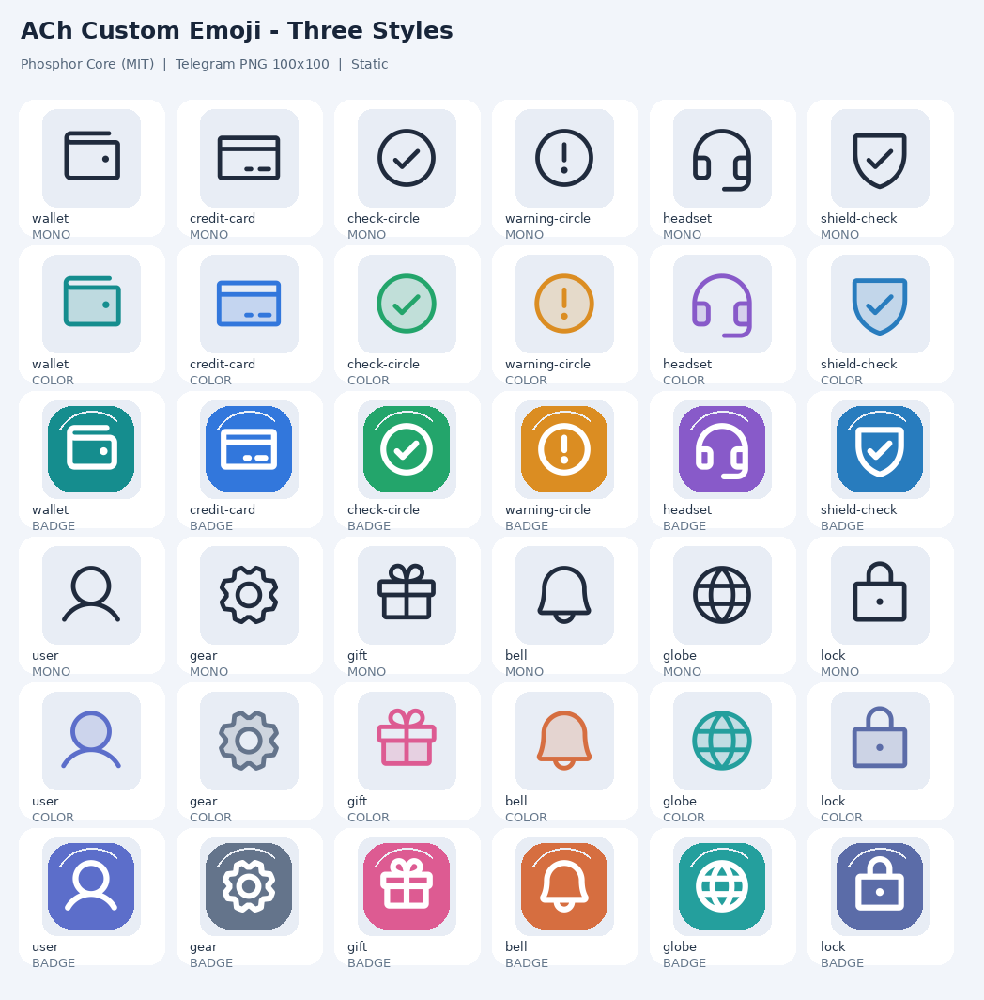

# ACh Telegram Emoji

A public workspace for designing, curating, generating, and eventually publishing **Telegram Custom Emoji and Sticker packs**.

> مخزن پروژهٔ ACh برای ساخت و مدیریت پک‌های اختصاصی ایموجی و در آینده استیکر تلگرام. منابع و مراحل کار در همین مخزن نگهداری می‌شوند.

**Status:** Foundation and offline tooling. **No Telegram pack has been published by this repository.**



## What is already here

- **Source list:** [icon libraries, URLs, and license considerations](docs/ICON-SOURCES.md).
- **Telegram references:** [candidate packs and links](docs/TELEGRAM-PACKS.md).
- **Static icon renderer:** `render_icon_pack.py` converts Phosphor SVG icons to transparent Telegram-sized PNGs in three styles: `mono`, `color`, and `badge`.
- **Sample assets:** 12 icons × 3 styles, plus cached upstream SVGs, manifest, preview and upstream MIT license in `assets/` and `previews/`.
- **Telegram pack workbench (experimental):** `emoji_tool.py` can import emoji from public packs by short name, collect chosen emoji from an authorized bot chat, list/remove selections, archive original media, and prepare a new set via Bot API. **Real-account import/publish remains unverified.**
- **Offline tests:** `tests/test_emoji_tool.py`.

## Developer quick start

```bash
python3 -m venv .venv
.venv/bin/python -m pip install -r requirements.txt
python3 -m unittest discover -s tests -v
.venv/bin/python render_icon_pack.py
```

The renderer downloads only the required Phosphor SVGs at a pinned upstream revision, then caches them in `assets/sources/phosphor/`. It does not require a Telegram token. You can select icons with `--icons wallet,gear,credit-card`. See [development and Telegram procedures](docs/DEVELOPMENT.md).

## Direction

1. Curate or import licensed emoji and icons; allow selections rather than copying every item.
2. Generate consistent styles and compare them at **actual Telegram display sizes**.
3. Assemble and validate Custom Emoji sets, then publish only after explicit owner approval.
4. Extend the same project to **regular/static and animated/video Telegram Stickers** when that phase is authorized.

The durable project scope and completion criteria are in [PROJECT-SPEC](docs/PROJECT-SPEC.md). Unfinished work belongs in [GitHub Issues](https://github.com/AChWorks/ach-telegram-emoji/issues) rather than chat history.

## Attribution and licensing

The Phosphor sample icons are licensed **MIT** by their respective copyright holders; their unmodified license is included in [`assets/sources/phosphor/LICENSE.phosphor.txt`](assets/sources/phosphor/LICENSE.phosphor.txt) and the source revision is recorded in the manifest. Other recommended libraries may require attribution or have different redistribution rules. The linked library is **not** automatically imported or licensed by this repository. See [ICON-SOURCES](docs/ICON-SOURCES.md).

**No repository-wide license for original ACh code has been selected yet.** Public visibility alone does not grant reuse permission. Decide a project-wide license deliberately before promoting this as a reusable open-source product.

Never commit bot tokens, service credential IDs, operator identities, chat contents, local `data/` selections, virtual environments, or private imported files.
